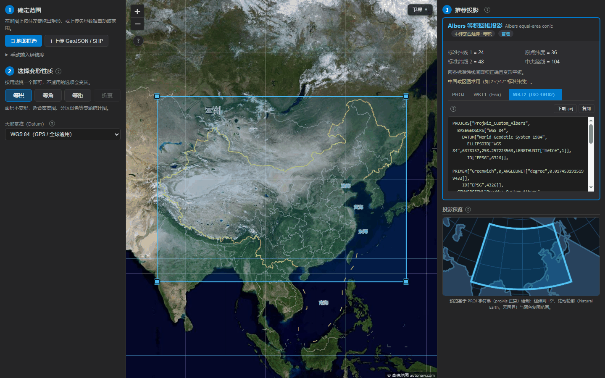

# 地图投影选择向导 · Map Projection Wizard (CN)

> 两步选对地图投影：框个范围、点个变形性质，直接拿到 **PROJ / WKT1 / WKT2** 和可导入 ArcGIS 的 **.prj** 文件。
> 单文件、纯离线、零依赖，双击即用。

一个面向 GIS 初学者与制图从业者的投影选型工具。推荐逻辑忠实复刻 [Projection Wizard](https://projectionwizard.org) v2.1（CC BY）的选择规则，并补齐了中文界面、国标知识与 WKT2 输出。



## 它能做什么

- **两步出结果**：① 在地图上拖个矩形（或上传 GeoJSON/SHP）→ ② 选等积/等角/等距/折衷 → 得到推荐投影、参数与可复制的坐标串。
- **三种输出格式**（标签页切换，默认 WKT2）
  - `PROJ` —— 粘进 PROJ / GDAL / QGIS / pyproj 即用
  - `WKT1（Esri）` —— ArcMap、ArcGIS Pro 3.5 及更早、shapefile 的 .prj
  - `WKT2（ISO 19162）` —— ArcGIS Pro 3.6+ 默认格式，GDAL 3+ / QGIS 3.x / PostGIS 通用
  - 两个 WKT 都支持 **下载 .prj**，直接拖进 ArcGIS/QGIS 即可定义坐标系
- **参数表**：标准纬线、中央经线、原点纬度、比例因子逐项列出，不用自己去 PROJ 串里扒。
- **投影预览**：按生成的 PROJ 串实时正算，画出经纬网、陆地轮廓与制图范围，一眼看出形变。
- **合规底图**：内置经纬网参考模式（Natural Earth，完全离线）；可选接入高德矢量/卫星底图。
- **国标知识库**：内置 GB 35650、GB/T 45792、GB/T 12343 等标准的投影条款卡片，选型时可直接对照。

## 快速开始

```bash
# 方式一：直接使用（推荐）
# 下载 dist/projection-wizard.html，双击用浏览器打开即可，无需安装任何东西

# 方式二：从源码构建（把内联数据重新生成一遍）
python scripts/build_land_data.py     # 重新生成陆地轮廓内联数据
# 页面源码就在 assets/template/index.html，改完直接另存为 dist/projection-wizard.html
```

页面完全离线运行：Leaflet、proj4js、shpjs 与陆地轮廓数据全部内联在单个 HTML 里，断网也能选投影、出参数、导出 .prj（只有切到高德底图时才需要联网）。

## 作为 WorkBuddy 技能安装

本仓库同时是一个 [WorkBuddy](https://www.workbuddy.cn) 技能包，`SKILL.md` 是技能入口。

```bash
git clone https://github.com/<your-name>/projection-wizard.git \
  ~/.workbuddy/skills/map-projection-wizard
```

之后在 WorkBuddy 里说"帮我选个投影""这个范围用什么投影"即可自动触发。

## 推荐逻辑是否可信

不是拍脑袋的经验值，而是一条可复现的规则链：

1. 由包围框算出经度跨度 `dlon`、尺度量 `scale`、南北比 `ratio`；
2. 按 `scale` 分档（世界 / 半球 / 区域），按 `ratio` 判断东西延伸还是南北延伸；
3. 在每个分档 × 变形性质的分支里挑出候选投影，圆锥投影还要过一遍**锥顶点有效性检查**（极点越界就换极球面/方位投影）；
4. 参数按 EPSG 惯例取值（如 6 等分纬差、标准纬线取 1/6 与 5/6 处）。

WKT 输出做过逐字段校验：31 个推荐组合与 PROJ 9（pyproj）的权威输出比对，WKT1 参数零差异、WKT2 在 4 个采样点上偏差 < 0.5 m，全部能被 `CRS.from_wkt()` 正确读回并识别为投影坐标系。

## 目录结构

```
├─ dist/projection-wizard.html   # 单文件成品（下载即用）
├─ assets/template/index.html    # 页面源码
├─ references/
│  ├─ projection-rules.md        # 推荐规则完整说明（改逻辑必读）
│  └─ standards/                 # 国标投影条款卡片
├─ scripts/build_land_data.py    # 陆地轮廓内联数据生成脚本
└─ SKILL.md                      # WorkBuddy 技能入口
```

## 已知边界

- 只做**几何启发式**推荐（Projection Wizard 的规则），不替代国标/行业规范；命中标准时以标准条款为准，带号、`x_0`、`k`、双标准纬线常需人工改。
- 世界伪圆柱族（Mollweide、Robinson、Eckert IV、Wagner、Natural Earth、Winkel Tripel、Patterson、Hammer）在 WKT2 里没有 EPSG 方法码，ArcGIS 可能识别为自定义投影——这类情况建议用 `WKT1（Esri）` 的 .prj。
- 部分投影（Wagner IV/VII、Patterson、横圆柱等积、两点等距）浏览器端无法预览，页面会明确提示，不会假装加载失败。
- 高德瓦片为可选增强，对外分发请遵守其服务条款。

## 致谢与许可

- 推荐逻辑基于 **Bojan Šavrič & Bernhard Jenny** 的 [Projection Wizard](https://projectionwizard.org) v2.1（**CC BY**），本项目为其离线中文重实现，**未复制其源码**。
- 方法论见 John P. Snyder, *Map Projections: A Working Manual*（USGS PP 1395，公有领域）。
- 代码：**MIT**；文档与规则卡片：**CC BY 4.0**。完整第三方清单与署名要求见 [NOTICE.md](NOTICE.md)。

---

## English

A two-step, fully offline map-projection picker that outputs **PROJ strings, WKT1 (Esri) and WKT2 (ISO 19162)** — plus one-click **.prj** download for ArcGIS.

1. Draw an extent on the map (or upload GeoJSON/SHP).
2. Pick a distortion property (equal-area / conformal / equidistant / compromise).
3. Copy the CRS definition or download a `.prj`.

Recommendation logic is a faithful re-implementation of [Projection Wizard](https://projectionwizard.org) v2.1 by Šavrič & Jenny (CC BY). Single HTML file, no build step, no network required except optional basemap tiles.

License: MIT for code, CC BY 4.0 for docs. See [NOTICE.md](NOTICE.md).
